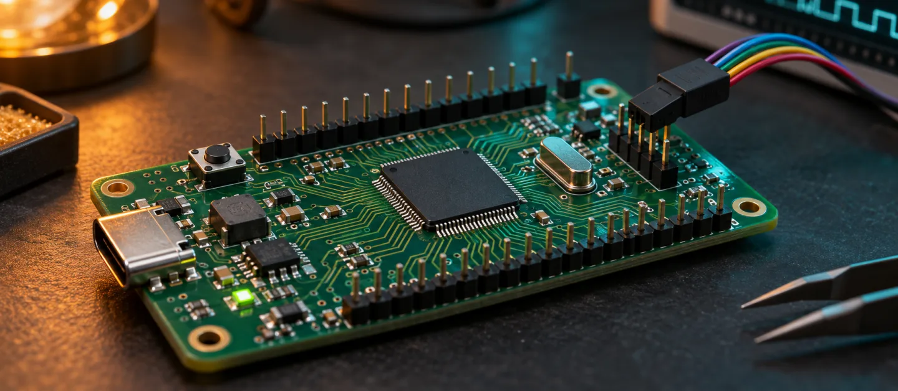

# Embedded Policy Pack for Nool



Add firmware rules to the changes you review in [Nool](https://www.nool.dev/).
For example, the pack can catch a print call in an interrupt handler, a
hard-coded Wi-Fi password, or a build flag that disables secure boot. Nool
reports the rule ID and the file so the author can fix the change before it
lands. The same checks apply to people and coding agents.

Start with the policies closest to the problems you see in your firmware. The
setup below walks through a connected-device example and ends with a quick
check that proves a policy is active.

## Pick your policies

| If you work on… | Start with… |
|---|---|
| Bare-metal C firmware | `emb_hardware_fit`, `emb_resource_bounds`, `emb_c_subset` |
| RTOS firmware | `emb_runtime_safety`, `emb_resource_bounds`, `emb_hardware_fit` |
| A connected device with over-the-air updates | `emb_security_baseline`, `emb_firmware_integrity`, `emb_runtime_safety` |
| Safety-related C firmware | `emb_c_subset`, `emb_resource_bounds`, `emb_safety_process` |
| C++ firmware | `emb_cpp_subset`, `emb_resource_bounds`, `emb_hardware_fit` |
| A bootloader or update component | `emb_firmware_integrity`, `emb_security_baseline`, `emb_c_subset` |

These are starting points. On a legacy codebase, try one policy first. The
pack checks the whole file when you edit it, so a small fix can surface an
older violation in that file. [Policy selection and adoption guide](docs/GUIDE.md#3-choose-your-policies)

### What each policy checks

| Policy | Examples |
|---|---|
| `emb_c_subset` | Flags `goto`, `setjmp`, assignment inside conditions and other patterns covered by MISRA C, BARR-C and CERT C. Refuses C newer than the C version you set, and build files that select another version. |
| `emb_cpp_subset` | Flags C-style casts, banned headers, variadic functions and other restricted C++ constructs. Refuses C++ newer than the C++ version you set, and build files that select another version. |
| `emb_resource_bounds` | Checks heap use, recursion and loops whose bounds the policy cannot establish. |
| `emb_hardware_fit` | Checks code against the configured RAM, flash, FPU and execution model. |
| `emb_security_baseline` | Flags embedded credentials, unsafe string functions and disabled TLS verification. |
| `emb_runtime_safety` | Flags blocking calls in interrupt handlers, interrupts left disabled and unsafe watchdog use. |
| `emb_firmware_integrity` | Flags weakened build and boot settings, such as disabled rollback protection or development signing keys. Requires a breaking change to a linker script or partition table to change a version file. |
| `emb_safety_process` | Checks for disabled tests, suppressed analysis findings and missing requirement tags where applicable. Before push, it requires review of deviations, profile changes and changes that span firmware images, and a target test run for hardware-facing changes. It warns about edits to generated vendor code. |

The pack implements 90 rules across these eight policies. The guide lists their
source clauses and describes what each rule checks. [Full policy reference](docs/GUIDE.md#7-the-policies)

## Set up in your firmware repository

The example uses the three connected-device policies above. Substitute the
names you chose in both the build and install commands.

### 1. Install the tools and clone the pack

Install Nool and Rust. The Nool installer puts the policy SDK in `~/.nool/sdk`.
Check the CLI and add the Rust target used to build the policies.
[Nool installation](https://www.nool.dev/setup)

```sh
nool --version
rustup target add wasm32-unknown-unknown
git clone https://github.com/noolinc/EmbeddedPack.git embedded-policy-pack
cd embedded-policy-pack
pack_dir="$PWD"
```

The Cargo manifests use local SDK paths. In `Cargo.toml`, point
`nool-aram-policy-sdk` at your SDK directory. In
`crates/emb-policy-glue/Cargo.toml`, do the same for `nool-policy-abi`.

### 2. Check the hardware profile and build the policies

Edit only the settings your chosen policies use in
[`hardware-profile.toml`](hardware-profile.toml) in the pack clone.

| Policy | Settings to check |
|---|---|
| `emb_hardware_fit` | RAM, flash, FPU, execution model, heap policy and stack-object limit |
| `emb_resource_bounds` | Heap policy and maximum function length |
| `emb_runtime_safety` | Execution model. This controls the check for non-reentrant calls. |
| `emb_safety_process` | Safety classification, which determines when production code needs requirement tags. Optionally `[evidence]` for target test runs and `[images]` for separately flashed images. |
| `emb_c_subset`, `emb_cpp_subset` | Optionally `[language]`: the C and C++ versions your compiler builds, and whether `.h` files are C++. |
| `emb_firmware_integrity` | Optionally `[compatibility]`: other files whose layout persists on devices, and your version files. |
| `emb_security_baseline` | The board and architecture settings can stay as shipped. |

**Check `[safety]` separately.** Every policy uses the safety classification
when deciding whether a strict rule can be waived. The sample uses ASIL B,
IEC 62304 class B and SIL 2, which activate requirement tracing when
`emb_safety_process` is installed. Use your project's actual levels. If your
project has no assigned levels, omit the `[safety]` section or set the entries
to `"QM"`, `"none"` and `0`, respectively.
[Hardware profile guide](docs/GUIDE.md#5-the-hardware-profile)

Run this from the pack clone. It runs the rule tests, builds the chosen
policies, and tests them in throwaway Nool repositories. Look for
`ALL CHECKS PASS` before moving on.

```sh
tools/check.sh emb_security_baseline emb_firmware_integrity emb_runtime_safety
```

Every policy binary embeds this file when it is built. Keep it in the pack
clone for the build. The firmware repository can use the installed binaries
without a copy of the TOML file. To apply new settings, rebuild and reinstall
your selected policies. If `emb_safety_process` is installed in the repository
where you commit a profile change, it requires an `emb-profile-review`
approval before push.

### 3. Install into your firmware repository

Stay in the same shell so `pack_dir` is still set. Change into your firmware
repository and run `nool init` if it has never used Nool. On Enterprise builds
that require an editor contract for this key, run
`nool admin contract grant --role editor` before installing.
[Nool quickstart](https://www.nool.dev/docs/quickstart)

```sh
cd /path/to/your-firmware
for policy in emb_security_baseline emb_firmware_integrity emb_runtime_safety; do
  nool admin plugin install "$pack_dir/policy-src/$policy/$policy.toml" --policy
done
nool admin plugin list
```

Check that all three policies appear. Nool Community allows up to three
policies, Team allows eleven, and Enterprise has no limit. Compiled policies
and declarative rules share that allowance. [Aram policy reference](https://www.nool.dev/docs/policies) · [Nool editions](https://www.nool.dev/pricing)

### 4. Check that a rule fires

In a trial checkout of your firmware repository, use the commands below to
propose a C file containing a fake password. This uses
`emb_security_baseline` from the example. Nool should refuse the proposal
with `EMB-SEC-001`. The last two commands clean up the temporary file and
directory.

```sh
smoke_dir=$(mktemp -d ./embpack-smoke.XXXXXX)
printf 'const char *wifi_password = "hunter2-factory";\n' > "$smoke_dir/smoke.c"
nool propose --path "$smoke_dir/smoke.c" --intent "Check the firmware policy" \
  --why "Verify that the security policy catches a fake password" --solidify
rm "$smoke_dir/smoke.c"
rmdir "$smoke_dir"
```

If the file lands, pause before adopting the policy and check whether it is
installed and active. [Check your installation](docs/GUIDE.md#8-checking-the-installation)

## Working with the policies

- **When a proposal is refused**, start with the rule ID and the named file.
  For example, `EMB-RT-001` can point to a `printf()` inside a UART
  interrupt handler. Move the printing into a thread, then propose the change
  again. [Reading a refusal](docs/GUIDE.md#reading-a-refusal)
- **When you need a deviation**, check whether the rule allows one. Put the
  reason next to the code. With `emb_safety_process` installed, the change
  can land locally and wait for a trusted reviewer to sign before you push.
  Add reviewer public keys to `checker_keys` in the `[attestation]` section
  of `nool.toml` before relying on that workflow.
  [Getting a deviation approved](docs/GUIDE.md#getting-a-deviation-approved)
- **When a change needs runtime validation**, keep your existing static
  analyser, CI and hardware tests. The policies inspect changed files for
  specific patterns. Use your build, tests and target measurements to check
  behaviour, stack use and timing. [Firmware host tests and TLA+ checks](docs/GUIDE.md#reification-and-tla)
- **To check flash and RAM use**, run `tools/size_budget.py` on the linked
  image. It warns and fails at the percentages in `[budget]`.
  [Flash and RAM budget](docs/GUIDE.md#flash-and-ram-budget)
- **To agree rule classes across teams**, record a re-categorization plan in
  `[recategorize]`. Following MISRA Compliance:2020, it can make a rule
  stricter or switch off an advisory rule, but never relax a required rule.
  Nool 8.0.2 does not yet display policy warnings, so advisory rules are not
  visible until you raise them to `required`. [Rule classes](docs/GUIDE.md#rule-classes)

## How this fits with Nool and Git

Nool can reserve files or symbols before people and agents edit them, run
configured validation before a change lands, and save the results with the
signed change record. The pack supplies eight sandboxed policies to Aram,
Nool's policy engine. Landed changes are mirrored as ordinary Git commits,
so your Git host, pull requests and CI stay in use.
[Nool features](https://www.nool.dev/features) · [Governance docs](https://www.nool.dev/docs/governance)

You can use the pack from the CLI, with Claude Code, Codex or opencode, or
with the bundled `nool code` agent. To inspect a landed change, run
`nool evidence knot <id>`. To see approvals and other signed verdicts for it,
run `nool attest show <id>`. To apply the same policy set across replicas,
use `nool admin plugin pin` to record its hashes in `nool.toml`.
[Nool coding agent docs](https://www.nool.dev/docs/nool-code)

### Roll out policies across repositories

A platform team can maintain the approved policy source and release
versioned WASM binaries and manifests for firmware teams to install. Reuse
the same build across repositories with the same profile. Build separate
variants when targets need different RAM, FPU, execution-model or safety
settings. Install and pin the approved policy set in each repository so
developers, CI and other replicas run the approved hashes.
[Policy pinning and workspace governance](https://www.nool.dev/docs/governance)

Before rolling out a policy, check its rules against your coding standard,
target and exception process. Make any required changes in the policy source
or profile. Run the rule tests and representative passing and failing
changes with `tools/check.sh`. Pilot the build in one repository, then
deploy that version to the others. Repeat the checks when the policy or
profile changes.

An Enterprise workspace can set common governance requirements and issuer
keys. Protect the shared branches and require a CI result that verifies the
approved policy set and evidence for the revision being merged. When those
checks are required, reviewers can use the recorded verdicts instead of
rechecking each enforced rule by hand. They can spend their review time on
design, test coverage, deviations and target behaviour.
[Nool with GitHub Actions](https://www.nool.dev/docs/github-actions) · [GitHub branch protection](https://docs.github.com/en/repositories/configuring-branches-and-merges-in-your-repository/managing-protected-branches/about-protected-branches)

## Firmware failures you can exercise

The runnable examples use small C programs to model three reported failure
modes. The Nool demo rejects a counter regression before landing and keeps
the scheduling and UART regressions off a shared branch. Signed passes
release the exact tested revision. [Run the demonstrations](examples/firmware-regressions/)

- **Mars Pathfinder priority inversion.** JPL enabled priority inheritance
  after a low-priority lock holder was delayed and a high-priority task
  missed its deadline. The demo checks the wait in a deterministic
  three-task schedule. An RTOS project can run the same kind of deadline
  assertion under its actual workload. [Glenn Reeves's firsthand account](https://retis.santannapisa.it/~giorgio/mars/reeves.html)
- **Boeing 787 counter overflow.** The FAA reported that a counter could
  overflow after 248 days of continuous power, sending the generator
  control units into failsafe mode together. The host example drives a
  representative counter through rollover and checks that the real
  timeout still fires. Nool blocks a proposal that fails that test.
  [FAA directive](https://www.federalregister.gov/documents/2015/05/01/2015-10066/airworthiness-directives-the-boeing-company-airplanes)
- **Zephyr STM32 UART timing.** The reported driver waited for transmission
  to finish before queuing more data. The demo models the timer-to-UART
  handoff and checks byte order, idle gaps, final completion and interrupt
  disable. The STM32H563 result still needs a Twister test and measurement
  on a board. [Zephyr issue #125432](https://github.com/zephyrproject-rtos/zephyr/issues/125432) · [Twister device testing](https://docs.zephyrproject.org/latest/develop/twister/index.html#running-tests-on-hardware)

One check already ships with this pack. `emb_runtime_safety` refuses a
`printf()` call inside a recognised interrupt handler with `EMB-RT-001`.
The end-to-end test checks that refusal through a real Nool proposal.
[Runtime safety test](tests/e2e/emb_runtime_safety.sh)

For checks that need a test runner, see how to run a blocking host check or
require a signed test result from CI. [Setting up validation gates](docs/GUIDE.md#reification-and-tla)

## More resources

- [Engineer's guide](docs/GUIDE.md) for the full rule reference, hardware profiles and troubleshooting.
- [Standards catalog](standards/CATALOG.md) for source documents and edition details.
- [Rule engine](crates/emb-rules/) and [policy crates](policy-src/) for implementation details.
- [End-to-end tests](tests/e2e/) for examples you can run against Nool.
- [Contributing](CONTRIBUTING.md) for adding a rule or fixing a false positive.
- [MIT license](LICENSE).
